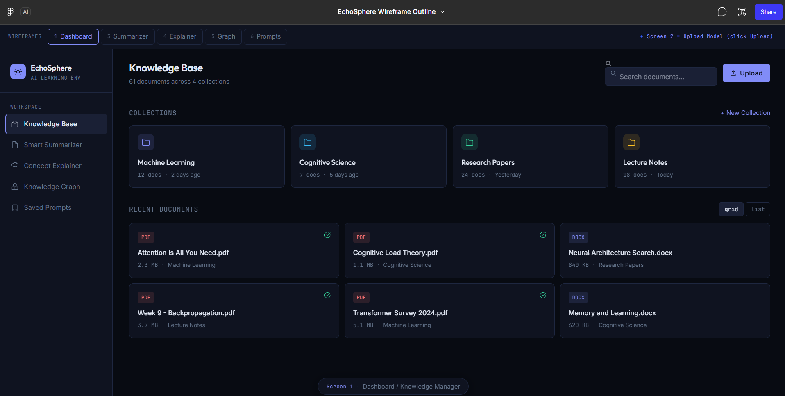
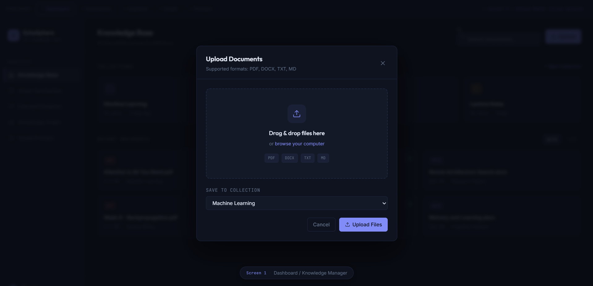
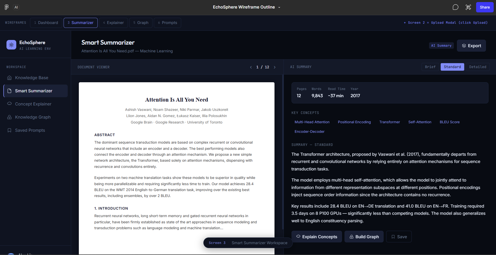
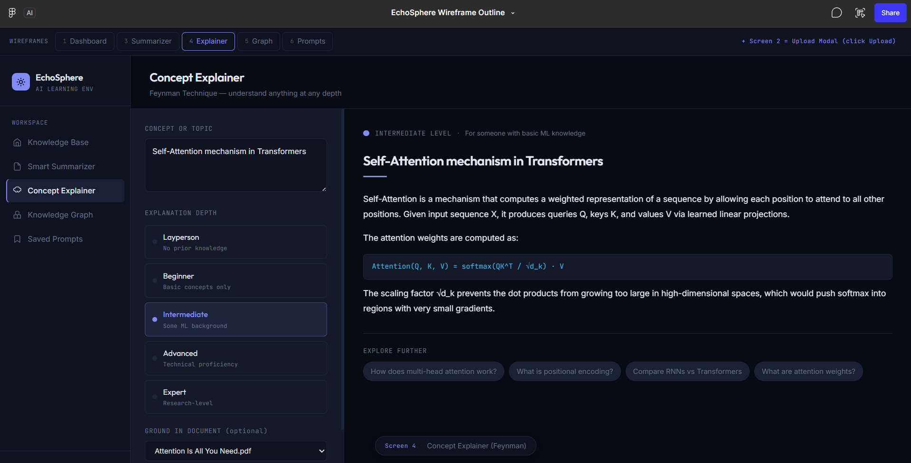
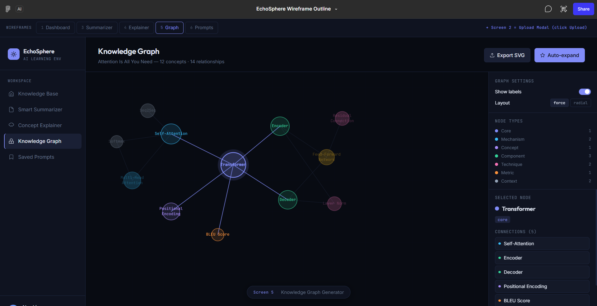
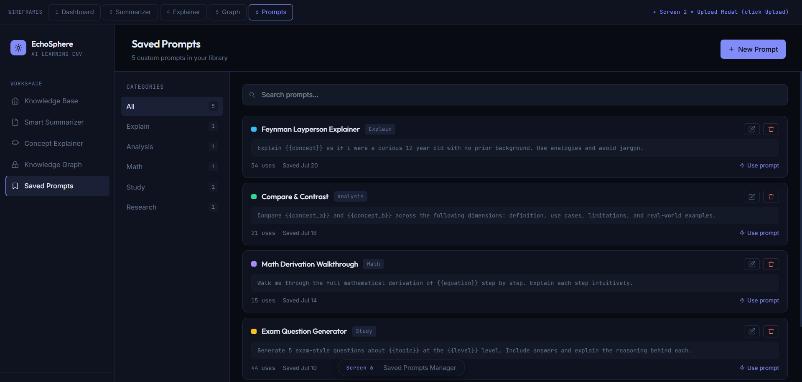
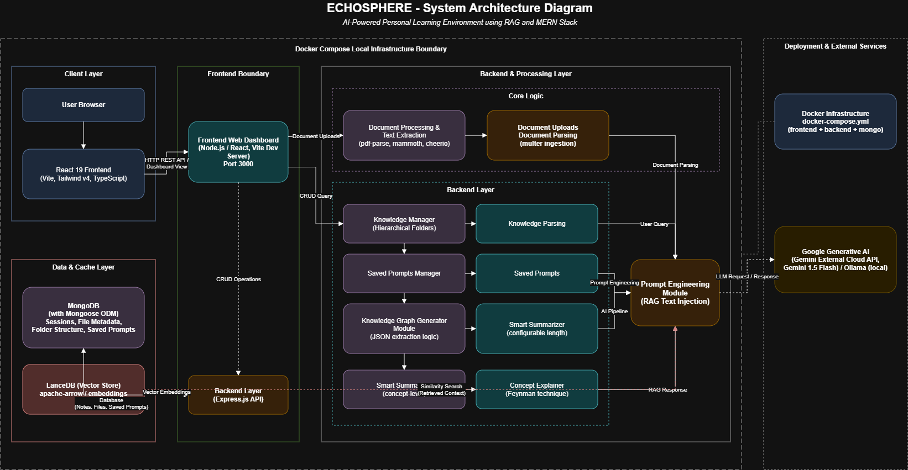

# EchoSphere: AI-Powered Personal Learning Environment

> **Digital Assignment 1 — Software Engineering**  
> **Student Name:** KAILASH P  
> **Register Number:** 24BRS1382  
> **GitHub Repository:** [kailashp-27/EchoSphere](https://github.com/kailashp-27/EchoSphere)  
> **Live Issues Board:** [EchoSphere Issues Tracker](https://github.com/kailashp-27/EchoSphere/issues)

---

## 1. Project Name & Overview

**Project Name:** EchoSphere

**Overview:**  
EchoSphere is a sophisticated, AI-powered personal learning environment and "smart chamber" designed to revolutionize how individuals interact with their personal knowledge bases. Built on a modern and scalable web stack (React frontend, Node.js/Express backend, and MongoDB for persistent storage), EchoSphere leverages state-of-the-art Retrieval-Augmented Generation (RAG) technology. This architecture empowers users to upload, organize, and securely store an extensive array of personal study materials—including academic papers, lecture notes, textbooks, and proprietary research documents.

Unlike generic AI assistants that rely on pre-trained public data, EchoSphere confines its context strictly to the user's uploaded data corpus. Users can query the integrated Large Language Model (LLM) to extract highly precise, context-aware answers, generate intelligent summaries, and visualize complex relationships without the risk of AI hallucination. Wrapped in an intuitive, distraction-free interface featuring customizable light/dark enterprise themes, sidebar navigation, and interactive knowledge graphs, EchoSphere provides a seamless and deeply immersive ecosystem for accelerated learning and robust knowledge management.

---

## 2. Problem It Solves

In the contemporary academic and professional landscape, individuals are increasingly paralyzed by acute information overload. The core issues EchoSphere addresses include:

* **Knowledge Fragmentation:** Crucial insights, data points, and concepts are frequently scattered across disparate file formats (PDFs, DOCX, TXT) and siloed note-taking applications, making holistic review nearly impossible.
* **Inefficiency of Traditional Search:** Standard keyword search mechanisms are rudimentary; they merely locate terms but fail to synthesize knowledge, extract nuanced context, or identify complex interdependencies between concepts across multiple documents.
* **The Hallucination Dilemma in AI:** While public LLMs (like ChatGPT or Gemini) are powerful, they frequently hallucinate or provide generalized information that is unacceptable for rigorous academic study or specialized professional research.
* **Friction in Information Retrieval:** The manual effort required to locate specific arguments, methodologies, or data within hundreds of pages of text disrupts cognitive flow and drastically reduces productivity.

EchoSphere mitigates these challenges by transforming static, unstructured document storage into a dynamic, interactive "smart chamber." It eliminates retrieval friction, ensuring that users can instantly extract synthesized insights and visualize conceptual connections derived *exclusively* from their trusted sources.

---

## 3. Target Users (Personas)

To ensure EchoSphere meets distinct user needs, the platform is designed with the following primary personas in mind:

### Persona 1: The University Student (e.g., Alex, 20)
* **Demographic & Background:** A junior university student double-majoring in Computer Science and Cognitive Psychology, handling a massive volume of dense coursework.
* **Pain Points:** Struggles to synthesize hundreds of pages of lecture slides, empirical research papers, and textbook chapters before midterms and finals. Alex frequently forgets where specific psychological theories were mapped to computational models across different semesters.
* **Goals & Use Case:** Alex needs a centralized hub to upload course syllabi, PDFs, and typed notes. Before a critical exam, Alex uses EchoSphere to query, *"Synthesize the relationship between neural networks and human cognitive memory models based on my Week 4 and Week 7 notes."* Furthermore, Alex utilizes the knowledge graph to visually map dependencies between syllabus topics, drastically reducing study time and improving retention.

### Persona 2: The Professional Researcher (e.g., Dr. Elena, 35)
* **Demographic & Background:** A postdoctoral researcher in Environmental Science currently conducting a comprehensive literature review for a meta-analysis on climate change mitigation strategies.
* **Pain Points:** Manages an unwieldy, constantly growing library of complex academic papers. Dr. Elena needs to meticulously cross-reference specific data points, statistical methodologies, and conclusions without the risk of AI tools fabricating information or pulling from irrelevant, non-peer-reviewed web sources.
* **Goals & Use Case:** Dr. Elena curates and uploads her localized library of PDFs to EchoSphere. She relies on the system's strict RAG implementation to execute highly specific queries (e.g., *"Extract the confidence intervals and sample sizes used in the carbon sequestration methodologies across all 2023 papers"*). She trusts the output because EchoSphere cites the exact documents and passages it used to generate the response.

---

## 4. Vision Statement

> *"To empower lifelong learners and rigorous researchers by transforming static, fragmented data into an interactive, strictly contextualized engine of rapid knowledge discovery and profound synthesis."*

---

## 5. Key Features & Architectural Goals

EchoSphere's architecture is driven by the following core features and technical objectives:

* **Strict RAG-Based Querying Engine:** An intelligent conversational interface that utilizes Retrieval-Augmented Generation to answer complex, multi-faceted queries strictly based on the user's uploaded document corpus, virtually eliminating external AI hallucinations.
* **Comprehensive Document Ingestion & Parsing:** A robust backend system allowing users to upload, organize in folders, and permanently store various file formats (PDFs, DOCX, raw text). It utilizes optimized parsing libraries (`pdf-parse`, `mammoth`) to accurately extract and sanitize text buffers.
* **Interactive Knowledge Graph Visualization:** Automated generation of dynamic, 2D physics-based network graphs (using `react-force-graph`). This tool visually maps out core concepts (Nodes) and their relationships/dependencies (Edges) automatically extracted from selected documents.
* **Customizable "Smart Chamber" UI/UX:** A sleek, highly responsive React frontend designed for deep focus. It features intuitive sidebar navigation, configurable light/dark enterprise themes (via Tailwind CSS), and isolated workspaces for different AI tasks.
* **Modular AI Tools (Summarizer & Explainer):**
  * **Smart Summarizer:** Condenses large, unwieldy documents into digestible formats, configurable by length (bullet points, medium overview, detailed report).
  * **Concept Explainer:** Employs the Feynman Technique, dynamically adapting explanations of complex topics to the user's chosen depth (e.g., beginner-friendly, child-like simplicity, or expert-level technical breakdown).
* **Secure & Dynamic Prompt Management:** A dedicated workspace to save, iterate, and manage custom AI prompts, coupled with dynamic API key configuration stored securely in the browser's local storage.

---

## 6. Success Metrics

To objectively evaluate EchoSphere's success and operational efficiency, the following quantitative and qualitative metrics are established:

| Metric | Target Goal | Description & Evaluation Method |
|---|---|---|
| **Query Performance & Latency** | **3 to 5 seconds** | 95% of RAG-based queries must return accurate, fully contextualized responses within this window to ensure a conversational experience. |
| **Ingestion & Parsing Reliability** | **≥ 99% Success Rate** | Parsing and vectorizing supported file formats (PDF, DOCX) without data loss, formatting corruption, or text garbling. |
| **User Retention & Engagement** | **60% WAU Retention** | 60% Weekly Active User retention among early adopters, with users executing 10+ intelligent queries per active session. |
| **Hallucination Rate (Fidelity)** | **< 1% Rate** | Near-zero instance of AI hallucinations verified via ground-truth comparisons and user upvote/downvote feedback loops. |
| **System Uptime** | **99.9% Availability** | High availability across frontend UI and backend API services during peak usage hours. |

---

## 7. Assumptions & Constraints

### Technical & Operational Constraints
* **Third-Party LLM Dependency:** The core cognitive intelligence relies on external LLM APIs (e.g., Google Gemini / local Ollama). The system is therefore subject to provider API rate limits, network latency, unpredictable downtime, and quota constraints.
* **Computational & Storage Overhead:** Processing, chunking, and embedding massive volumes of text (especially academic textbooks) require significant backend memory and database storage (MongoDB). This may incur computational bottlenecks during document ingestion.
* **Complex Document Parsing:** Extracting clean text from highly formatted PDFs (multi-column papers with math formulas, embedded diagrams, and tables) presents algorithmic challenges in chunk alignment.

### Project Assumptions
* **User Technical Literacy:** Target users possess a baseline understanding of digital file management (uploading/organizing files) and interacting with conversational AI interfaces.
* **API Key Provision:** Users provide their own valid LLM API keys (e.g., Google Gemini) or connect to a local Ollama instance, shifting the API cost burden to the user in a localized deployment model.
* **Data Privacy Acceptance:** Users understand their uploaded text will be processed via LLM inference APIs to generate contextual answers.

---

## 8. User Stories (25 Tracked Issues)

All **25 User Stories** are systematically tracked as GitHub Issues on the repository project board:  
🔗 **Issues URL:** [https://github.com/kailashp-27/EchoSphere/issues](https://github.com/kailashp-27/EchoSphere/issues)

| Issue # | User Story Title | Functional Area | User Story Description |
|:---:|---|---|---|
| **#1** | **Upload PDFs** | Knowledge Manager | As a user, I want to upload PDF documents so that my study materials can be added to the knowledge corpus. |
| **#2** | **Upload DOCX** | Knowledge Manager | As a user, I want to upload Word DOCX documents so that my lecture notes are processed seamlessly. |
| **#3** | **Backend Parsing** | Backend Processing | As a system, I want to parse text buffers from raw uploads to prepare clean text for embeddings and RAG. |
| **#4** | **Raw Notes Generation** | AI Tools | As a student, I want to synthesize quick raw study notes directly from my uploaded files. |
| **#5** | **Folder Organization** | Knowledge Manager | As a user, I want to create and organize hierarchical folders to structure my multi-course materials. |
| **#6** | **Move Files** | Knowledge Manager | As a user, I want to move documents between collections/folders for clean workspace organization. |
| **#7** | **Delete Documents** | Knowledge Manager | As a user, I want to delete obsolete documents from storage and database indices. |
| **#8** | **Concept Extraction** | AI Pipeline | As a researcher, I want the system to extract key concepts and dependencies from my documents. |
| **#9** | **Visual Rendering** | Data Visualization | As a student, I want to visualize conceptual relationships as interactive visual nodes. |
| **#10** | **Interactive Nodes** | Data Visualization | As a user, I want to click and interact with graph nodes to inspect specific definitions and citations. |
| **#11** | **Physics-Based Layout** | Data Visualization | As a user, I want a 2D physics-based force layout that prevents node overlapping and clarifies clusters. |
| **#12** | **Quick Summaries** | AI Tools | As a student, I want instant executive summaries of dense research papers before exams. |
| **#13** | **Adjustable Length** | AI Tools | As a user, I want configurable summary lengths (brief, standard, detailed) for tailored learning. |
| **#14** | **Context-Strict Generation** | AI Pipeline | As a researcher, I want responses strictly confined to uploaded texts to eliminate hallucinations. |
| **#15** | **Targeted Inputs** | AI Tools | As a student, I want to select specific target documents for queries rather than whole-database search. |
| **#16** | **Beginner Mode** | AI Tools | As a student encountering a new topic, I want explanations framed with child-like simplicity (Feynman). |
| **#17** | **Expert Mode** | AI Tools | As a researcher, I want in-depth, rigorous technical breakdowns of complex methodologies. |
| **#18** | **Markdown Support** | UI/UX | As a user, I want rich Markdown rendering including math, code blocks, and formatted tables. |
| **#19** | **Save Prompts** | AI Tools | As a power user, I want to save custom prompt templates into a reusable library. |
| **#20** | **Manage Prompts** | AI Tools | As a user, I want to edit, categorize, and delete saved prompt templates. |
| **#21** | **Quick Apply** | AI Tools | As a user, I want one-click application of saved prompt templates to active study sessions. |
| **#22** | **Theme Toggling** | UI/UX | As a user, I want seamless toggling between dark and light modes for comfortable late-night study. |
| **#23** | **Sidebar Navigation** | UI/UX | As a user, I want a persistent, responsive sidebar to easily navigate between tools. |
| **#24** | **Local API Key Storage** | Authentication | As a user, I want to securely store my Gemini API key in `localStorage` without backend persistence. |
| **#25** | **Loading States** | UI/UX | As a user, I want visual skeleton loaders and indicators during intensive AI parsing operations. |

---

## 9. MoSCoW Prioritization

To ensure disciplined agile execution, the project scope is categorized according to the MoSCoW prioritization model:

| Priority | User Story | Feature Area | Justification |
|:---:|---|---|---|
| 🟢 **Must Have** | Upload and ingest PDF/DOCX files | Knowledge Manager | Foundational data source for the RAG pipeline; nothing works without study materials. |
| 🟢 **Must Have** | Parse and extract clean text (Backend) | Backend Processing | LLMs cannot read raw binary files; extracting text buffers is mandatory for all downstream AI tasks. |
| 🟢 **Must Have** | Secure local API key storage | Authentication / Security | Required to connect to Gemini AI without requiring a complex multi-tenant auth backend. |
| 🟢 **Must Have** | Generate basic document summaries | AI Tools | Core MVP feature proving end-to-end LLM integration and prompt execution. |
| 🟢 **Must Have** | Store and retrieve notes (MongoDB) | Database Persistence | Essential for persisting user state and documents across sessions; prevents stateless demo behavior. |
| 🟡 **Should Have** | Organize documents into folders | Knowledge Manager | Vital for usability as document counts scale, though flat file lists work as an initial fallback. |
| 🟡 **Should Have** | Extract nodes/edges for Knowledge Graph | AI Pipeline | Sets up the primary visual learning differentiator of EchoSphere. |
| 🟡 **Should Have** | Adjustable output lengths (Feynman/Summary) | AI Tools | High pedagogical value for tailored learning, though static lengths suffice for baseline MVP. |
| 🟡 **Should Have** | Persistent sidebar navigation | UI/UX | Major usability enhancement for fluid switching between tools without full reloads. |
| 🔵 **Could Have** | Interactive 2D Knowledge Graph UI | Data Visualization | High visual appeal using `react-force-graph`, but complex to render compared to core text tools. |
| 🔵 **Could Have** | Saved custom AI prompts workspace | AI Tools | Accelerates power-user workflows; manual prompt entry serves as functional fallback. |
| 🔵 **Could Have** | Enterprise Dark Mode toggle | UI/UX | Improves reading experience and accessibility for extended study sessions. |
| 🔴 **Won't Have** | Multi-user JWT login system | Infrastructure | Explicitly out of scope for single-user local deployment in this assignment milestone. |
| 🔴 **Won't Have** | Image OCR for scanned documents | Knowledge Manager | Excluded due to timeline constraints; current release focuses on text-selectable PDFs and DOCX. |

---

## 10. Figma UI/UX Wireframes

Interactive Figma Wireframe Outline:  
🔗 **Figma Design Link:** [EchoSphere Wireframe Outline](https://www.figma.com/make/o0oFJ9qgmdbQpxuekEYeyl/EchoSphere-Wireframe-Outline?fullscreen=1&t=5TR1E21N2il7zOKA-1&code-node-id=1-5)

### Screen Previews

#### 1. Knowledge Base Dashboard (Collections & Documents)


#### 2. Document Upload Modal


#### 3. Smart Summarizer Workspace


#### 4. Concept Explainer (Feynman Technique)


#### 5. Interactive 2D Knowledge Graph


#### 6. Saved Prompts Manager


---

## 11. System Architecture Diagram

EchoSphere is architected using a decoupled **MERN + RAG** design, containerized using Docker Compose.

* **Architecture Draw.io Source:** [Google Drive Draw.io File](https://drive.google.com/file/d/1ni_RgGjN7F9XYarQekSw0qokId5tgqU7/view?usp=sharing)
* **Local Diagram Source:** [`design/DRAWIO/echosphere_architecture.drawio.png`](./design/DRAWIO/echosphere_architecture.drawio.png)



### Architecture Highlights
* **Client Layer:** React 18 SPA built with Vite, TypeScript, and Tailwind CSS. State management includes persistent local storage for API credentials and theme states.
* **Backend Layer:** Node.js & Express REST API managing document uploads via `multer`, parsing text through `pdf-parse` and `mammoth`, and orchestrating RAG context windows.
* **Persistence & Database:** MongoDB with Mongoose ORM storing document metadata, parsed text chunks, hierarchical folder trees, and custom prompt templates.
* **AI & Inference Engine:** Integrated with Google Gemini 1.5 Flash and local Ollama options, enforcing strict context adherence to uploaded text to prevent hallucinations.

---

## 12. Repository Directory Structure

```
EchoSphere/
├── .gitignore
├── docker-compose.yml              # Multi-container orchestration (Frontend, Backend, MongoDB)
├── package.json                    # Workspace scripts
├── README.md                       # Comprehensive Vision & Architecture Documentation
│
├── design/                         # Design assets & diagrams
│   ├── DRAWIO/
│   │   └── echosphere_architecture.drawio.png
│   └── FIGMA/
│       ├── DashboardFIGMA.png
│       ├── UploadFIGMA.png
│       ├── SmartSummarizerFIGMA.png
│       ├── ConceptExplainerFIGMA.png
│       ├── KnowledgegraphFIGMA.png
│       └── SavedPromptFIGMA.png
│
├── backend/                        # Express.js REST API Server
│   ├── Dockerfile
│   ├── .env
│   ├── index.js                    # Server entrypoint (Port 5000)
│   ├── rag.js                      # RAG logic, prompt crafting, and LLM integrations
│   ├── reset-db.js                 # Database cleanup utility
│   ├── seed-prompts.js             # Initial prompt library seeder
│   ├── controllers/
│   │   └── knowledgeController.js
│   ├── models/
│   │   ├── Document.js             # Document schemas & text buffers
│   │   ├── Folder.js               # Hierarchical collection directories
│   │   ├── Graph.js                # Extracted nodes and relationship edges
│   │   ├── Note.js                 # Generated study notes
│   │   └── SavedPrompt.js          # User prompt templates
│   ├── routes/
│   │   ├── chat.js                 # Conversational RAG endpoints
│   │   ├── graph.js                # Graph extraction endpoints
│   │   ├── knowledge.js            # Upload and file management endpoints
│   │   ├── prompts.js              # Prompt management CRUD
│   │   └── tools.js                # Summarizer & Explainer endpoints
│   └── uploads/                    # Local temporary binary upload cache
│
└── frontend/                       # React 18 + Vite SPA
    ├── Dockerfile
    ├── index.html
    ├── vite.config.ts
    ├── tailwind.config.js
    └── src/
        ├── App.tsx                 # Core workspace router & theme provider
        ├── main.tsx
        ├── index.css
        └── components/
            ├── AppLayout.tsx               # Enterprise shell & persistent sidebar
            ├── Dashboard.tsx               # Primary overview & metrics
            ├── FileExplorer.tsx            # Tree-view document management
            ├── KnowledgeManager.tsx        # Upload & collection management
            ├── SmartSummariserWorkspace.tsx # Length-controlled summary engine
            ├── ConceptExplainerWorkspace.tsx # Feynman-method explanation tool
            ├── KgGeneratorWorkspace.tsx    # 2D Force-directed knowledge graph
            ├── SavedPromptsWorkspace.tsx   # Custom prompt manager
            ├── ExamPredictorWorkspace.tsx  # Exam questions generator
            ├── FlashcardGeneratorWorkspace.tsx # Interactive flashcards
            ├── MarkdownRenderer.tsx        # Styled markdown & syntax highlighter
            └── SettingsWorkspace.tsx       # Local API key & model settings
```

---

## 13. 🌿 Branching Strategy (GitHub Flow)

EchoSphere strictly adheres to **GitHub Flow** to ensure stability, continuous delivery, and transparent code reviews.

```
       (feature/pdf-ingestion)        ──●──●──●──┐
                                                 │ PR & Review
main  ●───────────────────────────●──────────────┴────────●───► (Production Ready)
                                  │                       ▲
                                  └──●──●──●──────────────┘
                         (feature/smart-summarizer)
```

1. **`main` Branch:** Always production-ready, clean, and tested. Direct commits to `main` are restricted.
2. **Descriptive Feature Branches:** Each feature or bug fix is isolated in its own branch branched from `main`:
   * `feature/smart-summarizer` *(Active)*
   * `feature/pdf-ingestion`
   * `feature/knowledge-graph-ui`
   * `bugfix/gemini-api-key-error`
3. **Pull Requests (PRs):** Completed features are submitted via PR for automated checks, lint validation, and review.
4. **Merge & Deletion:** Once approved, PRs are merged into `main` and feature branches are pruned to maintain a clean repository.

---

## 14. 🚀 Quick Start – Local Development

EchoSphere is fully containerized using **Docker Compose** to guarantee a 1-command startup without manual configuration of MongoDB or Node environments.

### Prerequisites
* [Docker Desktop](https://www.docker.com/products/docker-desktop) (Version 24.0+ recommended) installed and running.
* [Git](https://git-scm.com/) installed.

### Setup Instructions

1. **Clone the repository:**
   ```bash
   git clone https://github.com/kailashp-27/EchoSphere.git
   cd EchoSphere
   ```

2. **Verify Docker Installation:**
   ```bash
   docker --version
   ```

3. **Build and spin up the containers:**
   ```bash
   docker-compose up --build
   ```

4. **Access the application services:**
   * 🌐 **Frontend UI:** [http://localhost:5173](http://localhost:5173)
   * 🔌 **Backend REST API:** [http://localhost:5000](http://localhost:5000)
   * 🗄️ **MongoDB Database:** `mongodb://localhost:27017/echosphere`

5. **Configure API Key:**
   * Open the frontend in your browser.
   * Navigate to **Settings** (`⚙️`) in the sidebar.
   * Enter your Google Gemini API key (or configure your local Ollama endpoint). It is securely retained in your browser's `localStorage`.
